# Foundryshop

**A Photoshop-style drawing and layers toolbox for Foundry VTT — built for GMs who
sketch maps live, with a mouse or a pen tablet.**

Foundryshop turns Foundry's ordinary Drawings into a real drawing workflow: a
floating toolbox with a tool rail and brush bar, named palettes and textured
materials, nestable layers and groups, GM-controlled player presentation,
reusable stamps and labels, a tracing reference for copying a sketch, and
portable project files.

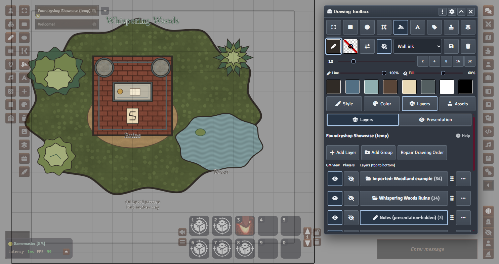

| | |
|---|---|
| **Version** | 1.0.0 |
| **Foundry VTT** | v14 (verified on 14.365). v13 and earlier are not supported. |
| **Requires** | [Precise Drawing Tools](https://github.com/shemetz/precise-drawing-tools) compatible with Foundry v14 |
| **Game systems** | System-agnostic |
| **Who uses it** | The Drawing Toolbox, layers and presentation are **GM-only**. Players simply see the result. |
| **License** | MIT |

---

## Contents

- [Installation](#installation)
- [Getting started](#getting-started)
- [The Drawing Toolbox](#the-drawing-toolbox)
  - [Tool rail](#tool-rail)
  - [Brush bar](#brush-bar)
  - [Selection bar](#selection-bar)
  - [Style panel](#style-panel)
  - [Paths: railway tracks, roads and rivers](#paths-railway-tracks-roads-and-rivers)
  - [Color panel](#color-panel)
  - [Layers panel](#layers-panel)
  - [Presentation panel](#presentation-panel)
  - [Assets: Stamps & Library](#assets-stamps--library)
  - [Assets: Labels](#assets-labels)
  - [Settings panel](#settings-panel)
- [Tracing a sketch](#tracing-a-sketch)
- [Projects, export and import](#projects-export-and-import)
- [Keyboard, pen and tablet](#keyboard-pen-and-tablet)
- [Module settings](#module-settings)
- [How it works (and what it does not do)](#how-it-works-and-what-it-does-not-do)
- [Troubleshooting](#troubleshooting)
- [Credits](#credits)
- [License](#license)

---

## Installation

### From the manifest URL

1. In Foundry's **Setup** screen open **Add-on Modules → Install Module**.
2. Paste this manifest URL and click **Install**:

   ```text
   https://github.com/Xombit/foundryshop/releases/latest/download/module.json
   ```

3. Launch your world, open **Game Settings → Manage Modules** and enable
   **Foundryshop**. Foundry offers to enable its required dependency,
   **Precise Drawing Tools**, at the same time — accept.

### Required: Precise Drawing Tools

Foundryshop requires [Precise Drawing Tools](https://github.com/shemetz/precise-drawing-tools)
by shemetz. It provides the high-resolution drawing that makes freehand lines,
shapes and labels look crisp. Installing Foundryshop from the manifest URL
installs it automatically. Precise Drawing Tools also requires **libWrapper**.
For a manual install, install both from Foundry's package browser first and
enable them in the world.

### Manual install

Download `module.zip` from the
[latest release](https://github.com/Xombit/foundryshop/releases/latest), extract
it to `Data/modules/foundryshop/` (so that `module.json` sits directly in that
folder) and restart Foundry.

For locally built ZIPs, the layouts are different:

- `dist/foundryshop-1.0.0.zip` contains the **foundryshop folder**. Extract it
  into `Data/modules/`.
- `packages/foundryshop-1.0.0.zip` contains the **module contents**. Extract it
  into `Data/modules/foundryshop/`, just like the GitHub `module.zip`.

In either case, the final path must be `Data/modules/foundryshop/module.json`,
not `Data/modules/foundryshop/foundryshop/module.json`. Restart the Foundry
server after copying files so it reloads the manifest, then enable Foundryshop
and its dependencies in **Manage Modules**. Do not copy the repository's
unbuilt `module.json`: it contains release placeholders.

### Coming from Boneyard Drawing Tools

Foundryshop uses its own module ID (`foundryshop`) and does not import settings,
colors or labels from Boneyard Drawing Tools. **Disable Boneyard Drawing Tools**
in worlds that use Foundryshop — both add drawing controls and both default to
**Ctrl+D**.

---

## Getting started

1. As GM, select the **Drawing Tools** layer in Foundry's scene controls. The
   Drawing Toolbox opens automatically (you can turn that off in
   [Module settings](#module-settings)). The toolbox button in the Drawing
   controls also opens and closes it.
2. Open **Layers** and click **Add Layer** — for example *Ground*, *Walls* and
   *Notes*. Click a layer's name to make it the **active layer**; every new
   drawing you make lands on the active layer.
3. Pick a tool on the **tool rail** (Freehand is a good start), choose a color
   from the swatches, set the width, and draw.
4. Use the eye buttons in each layer row: **GM view** hides or shows a layer for
   you only, **Players** decides whether players can see it.
5. Save a **presentation preset** (for example "Before the reveal") so you can
   switch everything players see in one click.

> Tip: Try the bundled examples first. Open **Assets → Stamps & Library** and
> import *The Wayfarer's Rest* or *Whispering Woods Ruins* into an empty Scene
> to see a full layered map.

---

## The Drawing Toolbox

The toolbox is a floating, draggable window. Everything you need while drawing
stays in the top half; the panels below hold everything else.

```
┌ Drawing Toolbox ───────────── ⋮  ⚙  ˄  ✕ ┐
│ Tool rail  (select, shapes, freehand…)    │
│ Brush bar  (stroke/fill, preset, width,   │
│             opacity, recent colors)       │
│ Selection bar (only while something is    │
│                selected)                  │
│ [ Style ] [ Color ] [ Layers ] [ Assets ] │
│ … active panel …                          │
└───────────────────────────────────────────┘
```

Header buttons:

- **⋮** is Foundry's standard window-controls menu.
- **⚙** toggles the Settings panel (click again to return to the panel you were on).
- **˄ / ˅** collapses the toolbox down to the rail and brush bar, then expands it again.
- **✕** closes the toolbox.

The toolbox remembers its position, collapsed state, last panel and the last
sub-panel of each group.

Dialogs keep their action buttons visible and scroll their content when it
does not fit on screen, including project export/import reviews.

### Tool rail

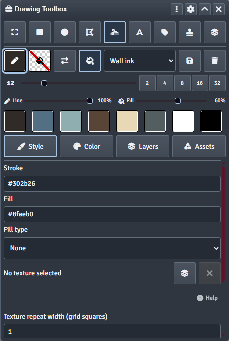

One button per tool, always visible:

| Button | Tool |
|---|---|
| Select | Select, move and resize drawings |
| Rectangle / Ellipse / Polygon | Foundry's shape tools |
| Freehand | Freehand pencil |
| Label | Opens the text/label workspace and arms the current label when available; click again to stop |
| Path | Draw waypoint-based plain paths, railway tracks, roads or rivers |
| Stamp | Arms the copied stamp for placement; click again to stop |
| Layers | Opens a compact quick-layer flyout to switch the active layer without leaving the brush |

Hover any button for a tooltip; every control also has an accessible label.
Foundry's native Text tool is available inside **Assets -> Labels** and in
Foundry's own drawing controls. It draws a text box for configuration, whereas
Label places the already composed text with a live preview.

### Brush bar

The brush bar controls what the **next** drawing looks like:

- **Stroke** and **Fill** swatches — click to open the color selector; the
  checkered swatch means "no fill".
- **Swap** exchanges stroke and fill colors.
- **Fill toggle** turns the interior fill on or off.
- **Brush preset** list, with **Save** and **Delete** — presets store line and
  fill color, width, opacity and pattern. Pick one to load it.
- **Width** slider plus one-tap widths **2 / 4 / 8 / 16 / 32**.
- **Line** and **Fill** opacity sliders.
- **Recent colors** — the colors you used most recently, one tap away.
- Scroll the mouse wheel over the width control to nudge it (Shift: ±5).

### Selection bar

When you select drawings, a slim bar appears under the brush bar showing how
many are selected. With exactly one drawing selected you can **edit its label
text**, **apply the current label** to it, or **clear** its text. **Copy** turns
the selection into a stamp (see [Stamps](#assets-stamps--library)).

### Style panel

Detailed brush settings: exact stroke and fill colors, **fill type**,
**textured materials**, and texture repeat size.

- **Materials.** Fifteen original seamless textures ship with the module —
  brick, cobblestone, flagstone, forest floor, grass, gravel, ice, packed earth,
  parchment, rough stone, sand, snow, timber planks, water ripples and wood
  grain. Pick one to use as the fill for new drawings, or explicitly apply it to
  the selected drawings' fill.
- **Texture repeat width** sets how many grid squares one tile of the texture
  covers.

### Color panel

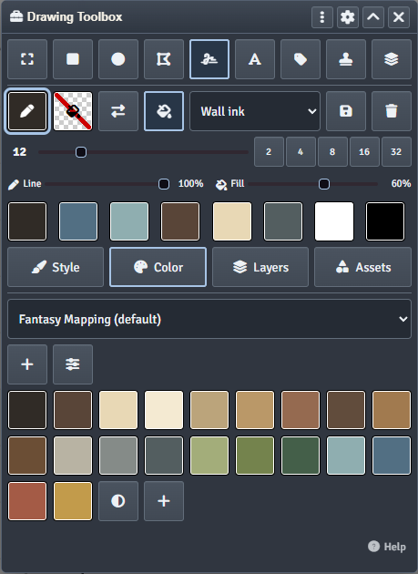

- **Named palettes.** Choose between built-in palettes (such as *Fantasy
  Mapping*) and your own. GMs can create, edit, import and share world palettes.
- **Swatches.** Click to apply the color to the current target (stroke or
  fill). Right-click a swatch to create or edit a **paired swatch**, which sets
  stroke and fill together; paired swatches can also be duplicated or deleted
  from the same menu.
- **Open color picker** opens the full color selector for the current target.
- **Color selector.** A full color picker with hex entry, an **eyedropper**
  that can sample anything on the canvas, a set of **preset swatches**, and
  **recent colors**.

### Paths: railway tracks, roads and rivers

The Path tool is also a general-purpose way to draw curved lines without a
freehand pen: choose **Plain line** for a line in your brush stroke color.
For a thin line, use a small width such as 0.05 squares (5 pixels on a
100-pixel grid); widths down to 0.01 squares are supported.

Create and activate a visible, unlocked layer first. Click the **Path** button
(route icon) in the rail to open **Style -> Paths** and arm waypoint placement.

1. Choose **Plain line**, **Railway tracks**, **Road** or **River**.
2. Keep the default **Smooth curve** to curve through your waypoints, or choose
   **Straight segments** for angular routes. **Curve amount** ranges from 0
   (straight) to 1 (fully smooth); lower values tighten the bends.
3. Set **Width** in Scene grid squares. For railways this is the separation
   between the rails; for the other styles it is the path's width.
4. For railway tracks, set **Sleeper spacing**, also in grid squares.
5. Click waypoints on the canvas. The preview follows the pointer.
6. **Double-click**, press **Enter**, or use **Finish path** to save.
   **Backspace** removes the last waypoint; **Escape** cancels without saving.
   Enable **Closed loop** before finishing a loop with at least three distinct
   points; do not click the first point again.

**Natural meanders:** every style has **Meander amount**, defaulting to 0 (off).
The value is the maximum sideways variation in grid squares. **Bend spacing**
appears when meander is enabled; smaller spacing creates more frequent bends,
while larger spacing creates broad, gentle variations. For a river, start with
amount **0.3** and spacing **3-4** squares, then adjust against the live preview.
Place reasonably spaced waypoints: meanders fade at every clicked point so
they cannot move the route's intended anchors.

Each new placement receives its own variation pattern. That pattern stays
stable while adding points or adjusting controls, rather than randomly jumping
on every mouse move. The last section can still change shape as its endpoint
moves. Saved native Drawings contain the actual resulting points; the retained
recipe also keeps the seed for later editing. Loading or exporting does not
regenerate artwork. Choose
**Straight segments** and set meander to **0** for a completely ordinary
angular line.

Plain lines and rails capture the brush stroke color/opacity when armed, unless
you explicitly selected path appearance or a path preset.
Roads use earth-colored edges and surfaces; rivers use blue banks, water and
a pale center line. Opacity applies to every component. The brush's line-width
slider does not set path width. Path **Primary color** changes the line/rails
or road/river surface; edges, water accents and wooden sleepers retain their
style colors. Save reusable appearance/geometry settings as **Path presets**;
applying one leaves the route's points and variation seed unchanged.

Smooth curves pass through the clicked waypoints, rather than rounding away
from them. Place points along the route you want; two points alone form a
straight line. The curve is adaptively sampled into native Drawing points:
the live preview, saved geometry and exports all use the same shape.
Railway sleepers follow the local curve direction and their spacing continues
along the whole route. Straight railway corners use bounded joins. Use shorter sections
for junctions, sharp bends or long tracks. A path is limited to 256 waypoints
and 100 component Drawings (railway sleepers count toward that limit).
Sampled curves/meanders are also bounded to 4096 points; increase bend spacing
or split a highly detailed route into shorter sections if it exceeds that limit.

Completed paths retain a Scene recipe and generate ordinary Foundry Drawing
components on the active layer, with no custom renderer or external images.
They support layer visibility, locks, project export/import, SVG/WEBP export
and tracing references. Put separate route sections on separate layers if you
want to reveal or hide them independently. These controls are GM-only: hidden
artwork is not a gameplay wall, and revealing a route does not change movement
or sight restrictions.

**Edit a finished path:** select any component and choose **Edit path** in the
selection bar, or open **Style -> Paths -> Saved paths** and choose a route.
The numbered waypoint list and canvas handles share the same draft. Drag a
point or enter its Scene-pixel X/Y coordinates; select **Automatic**, **Smooth**
(linked tangent directions) or **Corner** (independent handles). Use **Insert
waypoint** then click the curve, or delete the selected point. Inserting into a
non-meandering curve preserves its shape; meandering sections recalculate
between their new anchors. **Apply** saves the complete recipe and artwork;
**Cancel** discards the draft.

Appearance, width, closure and **New variation** also preview before Apply.
**Move whole path** translates every anchor and handle. Editing a transformed
or imported route retains its stored dimensional reference: the editor shows
the reference grid, current grid and resolved pixel width rather than silently
resizing artwork to a different Scene grid.

**History and whole-path actions:** draft Undo/Redo groups each drag as one
change (20 changes). While editing, Ctrl/Cmd+Z, Shift+Z or Ctrl/Cmd+Y work
outside text inputs; Enter applies, Escape cancels and Delete removes a point.
Saved **Path Undo/Redo** restores recipes and all affected Drawings together,
including creation, edits, duplicate, delete and normal detach. It is separate
from native Ctrl+Z and local to this GM, Scene and browser session (20 operations,
24 MiB). Reload, recovery, conflict detach and imports/stamps involving retained
paths clear it. Cancel a draft before whole-path actions. Duplicate creates an
independent route; delete and detach require confirmation. **Detach** keeps
the artwork but removes editability; detach before editing components individually.

**Portability and conflicts:** complete intact routes survive JSON projects,
whole-route copies and saved editable shapes, including stamp rotation/scale.
Select the whole route before copying. Partial or damaged exports retain current
ordinary artwork but lose recipe editability, with explicit disclosure. SVG/WEBP
are artwork exports, not editable recipe backups. External component changes
are never overwritten automatically: **Review conflict** offers Cancel or
confirmed safe detach, preserving edits and missing parts. Saved paths remain
reachable even when all their components are missing. Resolve any pending
Path/import recovery in Layers before continuing; recovery refuses unrelated
changes rather than guessing. New placement can also refuse mixed native
elevation/interface stacking; use a compatible drawing destination.

For a mine, search **minecart**, **ore**, **support**, **buffer** or **pickaxe**
in **Assets -> Stamps & Library**. The Mining category contains six original
editable stamps: empty and ore-loaded minecarts, an ore pile, timber support,
railway buffer stop and mining pickaxe. Use the existing stamp scale/rotation
controls to align a cart with the tracks.

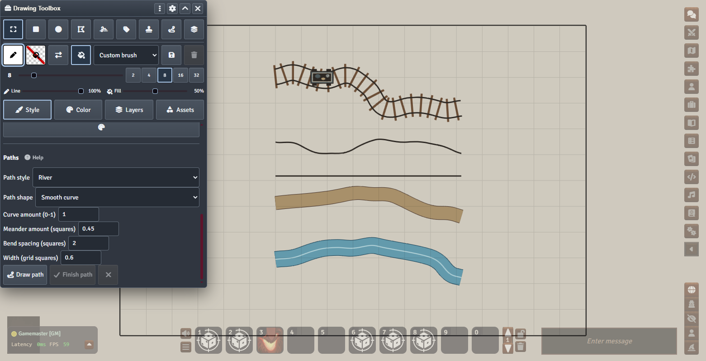

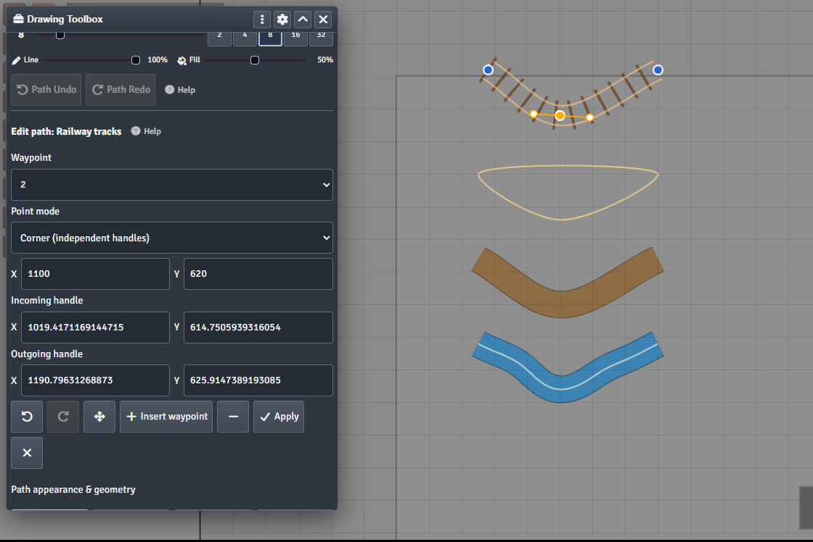

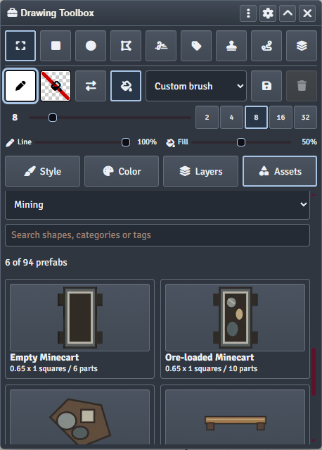

### Layers panel

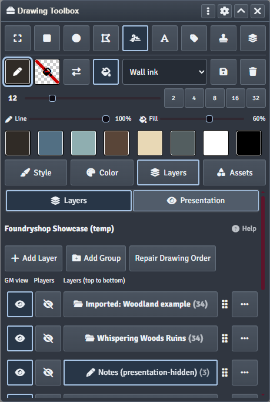

Layers are Foundryshop's organizing model: each drawing belongs to exactly one
layer, and layers can be nested inside **groups**.

- **Add Layer / Add Group**, then drag rows by the ⋮⋮ handle to reorder or
  nest them. The list is **top to bottom**, like Photoshop: rows nearer the top
  draw above the rows beneath them.
- **Active layer** — click a layer name. New drawings are assigned to it.
- **GM view (eye)** — hides or shows the layer *for you only*. Great for
  decluttering while you work.
- **Players (eye)** — whether players can see the layer. Hiding a group hides
  everything inside it but keeps each child's own setting for when you show the
  group again.
- **Unassigned** — drawings that are not on any layer (for example drawings that
  existed before you installed Foundryshop). Select them and use a layer's
  *Move selected drawings here* to adopt them.
- **Repair Drawing Order** re-applies the layer order to the canvas if another
  tool reshuffled it.
- **Scene Background** is shown at the bottom as a reminder that the Scene's
  background image always sits below every layer.

Each row's **⋯ menu** holds the less frequent actions:

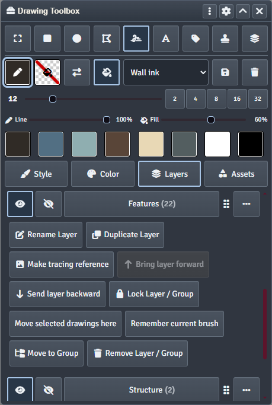

| Action | What it does |
|---|---|
| Rename Layer | Rename the layer or group |
| Duplicate Layer | Copies the layer and all of its drawings |
| Make tracing reference | See [Tracing a sketch](#tracing-a-sketch) |
| Bring layer forward / Send layer backward | Keyboard-friendly reordering |
| Lock Layer / Group | Prevents selecting, editing or deleting the layer's drawings (locks are inherited by children) |
| Move selected drawings here | Reassigns the selected drawings to this layer |
| Copy selected drawings here | Copies the selection to this layer at exactly the same coordinates, size, rotation and appearance; originals and active layer stay unchanged |
| Remember current brush | Saves the current brush as this layer's default, so activating the layer loads it (can be cleared again from the same menu) |
| Move to Group | Moves the row into another group |
| Remove Layer / Group | Removes the row and everything inside it. Choose a layer to move its drawings to, or tick *Delete its artwork too* (locked artwork blocks deletion) |

Groups additionally offer **Add layer / Add subgroup inside**, and
**Show all / Hide all** for both GM view and Players.

To make a seamless entrance overlap for a reveal, select the shared doorway or
middle-piece Drawings, then open the destination layer's **⋯ menu -> Copy selected
drawings here**. The copies stay precisely on top of their originals—even when
the destination layer is hidden—so revealing it does not introduce an offset.
The destination's layer visibility/presentation still governs the copies.
Native per-Drawing hidden state, Level and elevation are preserved.

Copy up to 100 Drawings at a time. Locked source artwork/layers or destinations
refuse copying. Complete retained paths become independently editable copies;
partial or damaged paths require confirmation and copy as ordinary artwork,
without changing the originals. Copy uses verified staging/recovery and may
adjust native sort values to respect layer order. Like path-bearing stamp imports,
it clears committed Path history when retained paths are present; unfinished
copies use the existing Layers import-recovery control.

### Presentation panel

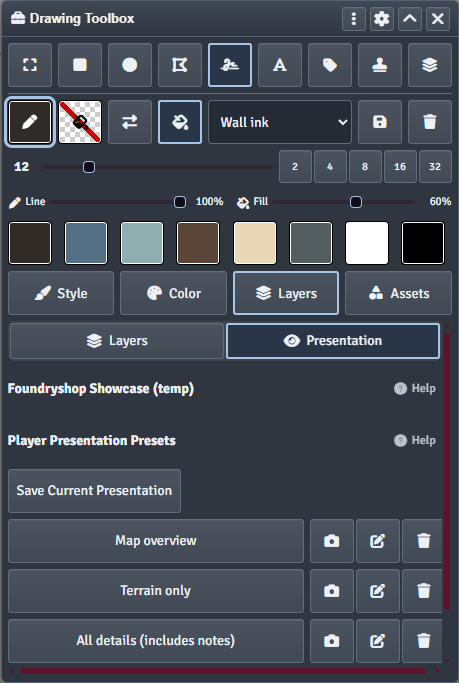

Presentation presets are snapshots of which layers players can see.

- **Save Current Presentation** records every layer's *Players* setting.
- Click a preset to apply it — players' view switches in one step.
- **Camera** re-captures the current state into the preset, **pencil**
  renames it, **trash** deletes it.

Presentation only ever changes what *players* see. Your GM view is never
changed by a preset.

### Assets: Stamps & Library

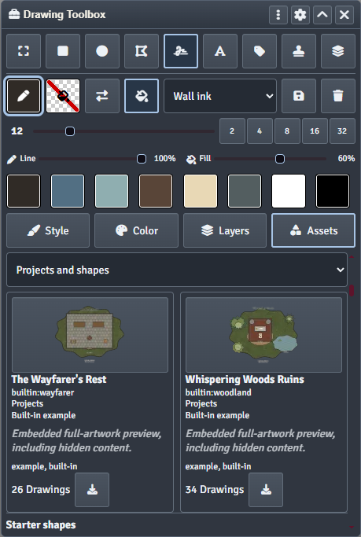

**Stamps** let you place the same artwork repeatedly:

- **Copy selected shape** turns the selected drawings into a stamp.
- **Import image** / **Paste image** turns a PNG, JPEG or WEBP into an image
  stamp (uploaded into the *Stamp image upload folder*).
- Set **Scale** and **Rotation**, enable **Repeat placement** to stamp several
  times, then click the canvas. A ghost preview follows the cursor; **Escape**
  cancels.

The **Library** is a searchable browser of projects and shapes:

- **94 built-in starter shapes** — trees, doors, furniture, terrain patches,
  columns, altars and more, some with textured fills. Click a preview to arm it
  for placement.
- **2 example projects** — *The Wayfarer's Rest* and *Whispering Woods Ruins*.
  Clicking a project opens an import review; nothing is created until you
  confirm.
- **Save shape** and **Save project** write your own artwork into the
  *Project library folder* (set this first in Module settings). Saved files get
  previews, names, categories and tags, and can be edited, duplicated, removed
  from the catalog and restored.
- **Export artwork WEBP** and **Export vector SVG** publish a picture of the
  current Level, a layer or a group — see
  [Projects, export and import](#projects-export-and-import).

### Assets: Labels

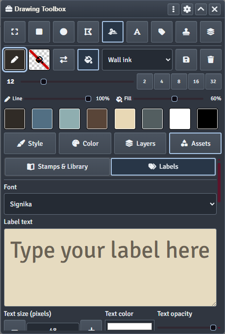

A composer for map text:

- Choose a **font**, type the label (multi-line is fine), and set **size**,
  **color** and **opacity**. The text box previews the result.
- **Save** stores the label in your label bank; 14 styled starter labels are
  included.
- Click a saved label to arm it, then click the canvas once to place it.
  **Escape** cancels.
- While placing: **Shift + mouse wheel** rotates by 15°, **Ctrl + mouse wheel**
  changes the font size by 1 px. Placement adjustments never overwrite the
  saved label.
- **Apply to selection** writes the label onto the one selected drawing.

### Settings panel

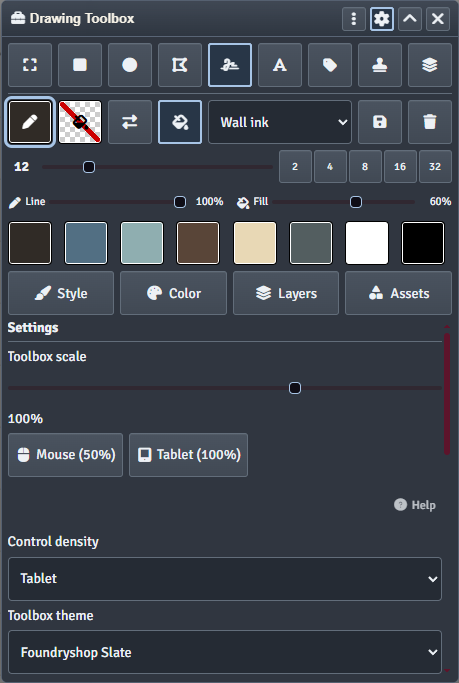

Opened with the **⚙** header button:

- **Toolbox scale**, with one-click *Mouse (50%)* and *Tablet (100%)* presets.
- **Control density** — *Compact*, *Comfortable* or *Tablet* (large targets for
  pens).
- **Toolbox theme** — *Foundryshop Slate* (default), *Foundry*, or *Game system*
  (picks up your system's sheet styling). Independent of Foundry's own
  light/dark setting.
- **Tablet setup** — a guide and a key tester for assigning tablet ExpressKeys
  (see [Keyboard, pen and tablet](#keyboard-pen-and-tablet)).

---

## Tracing a sketch

Have a rough sketch you want to redraw cleanly? Put it on its own layer and turn
it into a **tracing reference**:

1. Draw or import the sketch onto a layer, for example *Sketch*.
2. Open that layer's **⋯ menu → Make tracing reference**.
3. Foundryshop snapshots the layer into a **faded (50%), hidden, locked Tile**
   placed underneath your drawings, and hides the source layer in your GM view.
4. Make another layer active and trace over the faded copy.

Players never see the reference. After editing the source layer, choose
**Refresh tracing reference**; **Remove tracing reference** deletes the Tile.
To change how faded it is, adjust the Tile's opacity in its own configuration.

Reference images are stored in a `foundryshop-tracing/` folder in your user
data. Foundry offers no way for modules to delete files, so remove old reference
images with your file manager if you want the space back.

### Copy drawings from another Scene for tracing

1. On the source Scene, open **Assets -> Stamps & Library** and scroll past
   the library and starter examples to **Export Project JSON**. Choose the
   sketch layer (or the whole project) and the **active Level**.
2. Open the destination Scene and switch to the Level you want to draw on.
   In **Assets -> Stamps & Library**, choose **Import Project JSON** and pick the exported
   `.foundryshop.json` file. Use **additive** mode if the destination already
   contains drawings, or **empty Scene** mode if it does not. Review the preview
   and any resource warnings, then confirm the import.
3. Expand the imported group, then open the actual sketch **layer's**
   **... menu -> Make tracing reference**. This action works on a layer,
   not a group. If the sketch spans several layers, move those imported
   drawings into a single sketch layer first.
4. Create and activate a new layer for the clean drawing, then trace over
   the faded reference. The source Scene is unchanged; the imported artwork
   stays hidden from players.

Project JSON references image files rather than bundling them. Between
different Foundry installations, copy any custom textures too and use the
import resource mappings if their paths changed.

### Tracing on a different grid size

JSON import preserves Scene-pixel coordinates; it offers X/Y offsets but no
scale control. For a tracing-only copy, import first and create the tracing
Tile, then resize that single Tile instead of all the drawings.

Use `destination pixels per square / source pixels per square` as the scale
factor when you want to preserve the number of grid squares. For example,
moving from 100 px/square to 150 px/square means multiplying both the Tile's
width and height by 1.5. Select Foundry's Tiles controls, temporarily unlock
the reference to configure or move it, set both dimensions, and position it
against a recognizable landmark. Keep it hidden from players and lock it
again when aligned. Hide the imported sketch layer in GM view; draw on a new
active layer.

Different map crops or padding require manual alignment; the ratio alone does
not determine the correct position. **Refresh tracing reference** recreates
the Tile from the unscaled drawings, so it replaces your manual Tile sizing
and placement.

---

## Projects, export and import

Found under **Assets -> Stamps & Library** (scroll down for JSON exchange):

- **Export Project JSON** saves the whole drawing project, one layer/group
  subtree, or just the selected drawings — including layers, presets, artwork
  hidden from players and referenced resources. It is not a Scene backup and
  excludes your per-GM workspace settings.
- **Import Project JSON** either fills an **empty** Scene or **adds** to an
  existing one. Additive imports arrive in a new, player-hidden wrapper group
  (top level or inside a chosen unlocked group) and never change your existing
  artwork or its order. Every import shows a **review with a preview** first.
  After importing, review the result and then present it to players.
- **Save project / Save shape** (Library) store the same format in your project
  library folder, with optional embedded thumbnails.
- **Export artwork WEBP** renders a clean picture of the displayed Level, a
  layer or a group — for the player audience or the GM audience — with content
  or custom bounds, scale and quality, and optionally the Scene's base color or
  background image.
- **Export vector SVG** produces a true vector file with the same scope options.
  Text and raster content are flagged before export.

All file writes are verified by reading them back. If something goes wrong,
Foundryshop refuses success and tells you why rather than leaving half-written
files.

---

## Keyboard, pen and tablet

| Action | Default |
|---|---|
| Toggle the Quick Draw Config panel | **Ctrl + D** |
| Toggle Drawing Toolbox | *unassigned* |
| Turn off armed label | *unassigned* |
| Draw: Freehand pencil | *unassigned* |
| Tokens: Select / Move | *unassigned* |
| Cancel label or stamp placement | **Escape** |
| Rotate label while placing | **Shift + wheel** (15°) |
| Change label font size while placing | **Ctrl + wheel** (1 px) |

Assign shortcuts in **Game Settings → Configure Controls → Foundryshop**. They
start unassigned so they never collide with Foundry's own keys.

The panel strip is a single **Tab** stop: **← / →** switch panels, **Home /
End** jump to the first or last, and **Tab** moves on into the panel.

**Pen tablets.** Choose *Tablet* density, then use **Settings → Tablet setup**:
bind *Draw: Freehand pencil* and *Tokens: Select / Move* in Configure Controls,
then give two tablet ExpressKeys the same keystrokes in your tablet driver (for
example in a Wacom profile for your browser). The built-in key tester shows
exactly what each ExpressKey sends. Tool switching is blocked mid-stroke, and
pen pressure is not used.

---

## Module settings

In **Game Settings → Configure Settings → Foundryshop**:

| Setting | Scope | Purpose |
|---|---|---|
| Show Drawing Toolbox Automatically | Client | Open the toolbox when you select the Drawing layer |
| Drawing Toolbox Size | Client | Compact / Comfortable / Tablet controls |
| Toolbox theme | Client | Foundryshop Slate / Foundry / Game system |
| Toolbox scale | Client | Overall size of the toolbox |
| Auto-pan at Screen Edges While Drawing | Client | Pan the canvas when the pen reaches the edge |
| Project library folder | World | Where saved projects and shapes are written |
| Stamp image upload folder | World | Where imported/pasted stamp images are uploaded |
| Color Selector Size, Dropper Preview Size, Dropper Read Radius | Client | Color picker and eyedropper tuning |
| Preset Color Swatches, Recent Color History | Client | Swatches shown in the color selector |

---

## How it works (and what it does not do)

- **Everything is a normal Foundry Drawing.** Layers are an organizing layer on
  top of Foundry's own Drawing documents, stored in Scene and Drawing flags.
  Disabling the module leaves every drawing in place.
- **Presentation is not secrecy.** Player visibility uses Foundry's own hidden
  flag. It controls what players are shown, not what data reaches their client.
- **GM-only editing.** The toolbox, layers and presentation are for GMs in this
  release. Players see the presented result.
- **Levels.** Layers apply to the displayed Level; each drawing keeps its Level.
- **No file deletion.** Foundry's file API cannot delete files, so removing a
  library item removes it from the catalog only, and old tracing images stay on
  disk until you delete them yourself.
- **Not included in 1.0.0:** angle snapping, pressure-sensitive drawing,
  flattening/merging layers into images, and player-side drawing tools.

---

## Troubleshooting

| Problem | Fix |
|---|---|
| Thumbnails fail with "renderer unavailable" on an HTTP server | Update Foundryshop: thumbnail cache identity no longer requires HTTPS. Layer copies, stamps and project imports use equivalent SHA-256 fingerprints on LAN HTTP as well as HTTPS. Project-library file verification and Bake/recovery file workflows still require browser Web Crypto; use HTTPS for the full workflow. |
| The toolbox does not appear | You must be a GM. Select the Drawing layer, or use the toolbox button in the Drawing controls. Check *Show Drawing Toolbox Automatically*. |
| "Open an active Scene" in the Layers panel | Layers need a viewed Scene. View a Scene and the panel fills in again. |
| New drawings appear in *Unassigned* | Make a layer active by clicking its name. Locked layers cannot be active. |
| Layer order looks wrong on the canvas | Use **Repair Drawing Order** in the Layers panel. |
| Save project / Save shape is disabled | Set *Project library folder* in Module settings, and make sure your role may browse and upload files. |
| Stamp image import fails | Set *Stamp image upload folder* and check upload permissions. |
| Ctrl+D does two things | Boneyard Drawing Tools is still enabled — disable it. |
| A tablet ExpressKey does nothing | Use the key tester in Settings → Tablet setup to see what the key sends, then bind that exact keystroke in Configure Controls. |

---

## Credits

Foundryshop is developed by **[Xombit](https://github.com/Xombit)**.

It began as a continuation of
**[Boneyard Drawing Tools](https://github.com/operation404/boneyard-drawing-tools)**
by **Lich (operation404)**, which provided the original code and inspiration —
the Quick Draw Config panel, color selector, eyedropper, presets and recent
colors all come from that project. Thank you, Lich.

High-resolution drawing is provided by the required
**[Precise Drawing Tools](https://github.com/shemetz/precise-drawing-tools)**
module by **shemetz**.

All textures, starter shapes, example projects and starter labels are original
works created for Foundryshop and are distributed under the same license.

Browser-independent import/copy fingerprints use the MIT-licensed
[@noble/hashes](https://github.com/paulmillr/noble-hashes) SHA-256 implementation
when Web Crypto is unavailable. Its license ships with the module.

## License

[MIT](LICENSE). Both the original Boneyard Drawing Tools copyright and the
Foundryshop copyright are retained in the license file.
